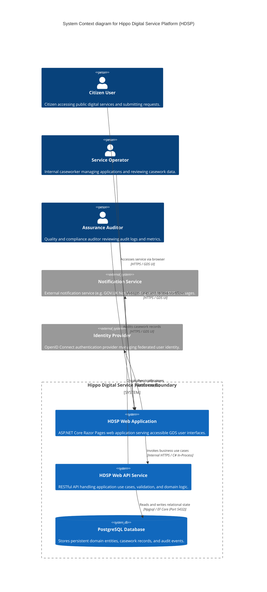

# Hippo Digital Service Platform — Architecture

## System Diagram



## Tech Stack

- **Runtime & Language**: .NET 8 LTS, C# 12
- **Web Presentation**: ASP.NET Core Razor Pages, GOV.UK Frontend (GDS tokens, accessible components)
- **API Framework**: ASP.NET Core Web API, Minimal APIs, OpenAPI / Swagger documentation
- **Persistence & ORM**: PostgreSQL 16, Entity Framework Core 8 (`Npgsql.EntityFrameworkCore.PostgreSQL`)
- **Database Migrations**: EF Core Code-First Migrations
- **Dependency Injection**: Microsoft.Extensions.DependencyInjection (built-in container)
- **Validation**: FluentValidation for request, command, and domain validation
- **Testing Libraries**: xUnit, FluentAssertions, NSubstitute, WebApplicationFactory, Playwright (.NET), Testcontainers for .NET, axe-core
- **Containerization & CI/CD**: Docker (multi-stage Linux builds), Docker Compose, GitHub Actions

## Layers

The platform implements strict Clean Architecture with dependency directions pointing strictly inwards:

1. **Domain Layer (`Hippo.Platform.Domain`)**:
   - Contains enterprise entities, value objects, domain logic, domain exceptions, and repository interface definitions.
   - Contains zero external package references or database dependencies.
2. **Application Layer (`Hippo.Platform.Application`)**:
   - Contains use case execution logic, CQRS command and query models, application interfaces, and validation rules.
   - Depends solely on the Domain layer.
3. **Infrastructure Layer (`Hippo.Platform.Infrastructure`)**:
   - Implements repository interfaces, EF Core `ApplicationDbContext`, database migrations, clock services, and external API clients.
   - Depends on the Domain and Application layers.
4. **Presentation Layer (`Hippo.Platform.Web`)**:
   - Host process containing ASP.NET Core Razor Pages, API controllers, GDS assets, middleware pipeline, and dependency injection composition root.
   - Depends on Application and Infrastructure layers.

## Key Patterns

- **Clean Architecture**: Strong isolation of domain logic from frameworks and infrastructure concerns ([ADR-0001](.memory/decisions/ADR-0001-clean-architecture-dotnet8.md)).
- **CQRS (Command Query Responsibility Segregation)**: Explicit separation between state-mutating commands and read-only query operations.
- **Repository and Unit of Work**: Abstract persistence interactions through explicit repository interfaces managed by EF Core change tracking.
- **Progressive Enhancement**: Server-rendered HTML first with client-side JavaScript enhancing interactions without breaking core functionality.
- **Secure by Design**: Anti-forgery tokens (CSRF) on all state-changing endpoints, strict Content Security Policy (CSP), and parameterized SQL statements via EF Core.

## Source code layout

```text
hippo-agents-test8/
├── .github/
│   └── workflows/
│       ├── ci.yml                     # Continuous integration workflow
│       └── release.yml                # Build and deployment workflow
├── .memory/                           # Architectural knowledge, decisions, and specs
│   ├── assumptions/                   # Project technical and business assumptions
│   ├── decisions/                     # Architectural and design decision records
│   ├── knowledge/                     # Reusable technical guides and patterns
│   ├── specs/                         # Structured feature specification workflows
│   ├── architecture.md                # System architecture documentation
│   ├── design-guidelines.md           # Visual, UI, and content design standards
│   ├── product-vision.md              # High-level product vision document
│   ├── specification-conventions.md   # Feature specification conventions
│   └── testing.md                     # Comprehensive test strategy
├── src/
│   ├── Hippo.Platform.Domain/         # Entities, Value Objects, Domain Events
│   ├── Hippo.Platform.Application/    # Use Cases, Commands, Queries, Validators
│   ├── Hippo.Platform.Infrastructure/ # EF Core, PostgreSQL Persistence, External Services
│   └── Hippo.Platform.Web/            # ASP.NET Core Razor Pages, GDS Views, API Endpoints
├── tests/
│   ├── Hippo.Platform.UnitTests/           # Fast isolated domain and application tests
│   ├── Hippo.Platform.IntegrationTests/    # Testcontainers PostgreSQL and API tests
│   └── Hippo.Platform.EndToEndTests/       # Playwright browser journeys and axe-core a11y tests
├── Hippo.Platform.sln                 # Main .NET solution file
├── .gitignore                         # Git exclusion rules
└── LICENSE                            # MIT License
```

## Data Flow

1. **User Request**: User sends HTTPS request to the Web presentation layer.
2. **Authentication & Authorization**: ASP.NET Core middleware validates user session or bearer token.
3. **Use Case Dispatch**: Web layer binds request input to a strongly typed Command or Query.
4. **Validation**: FluentValidation pipeline validates input fields before execution.
5. **Domain Execution**: Command handler loads domain entity through repository, invokes domain methods, and applies state changes.
6. **Persistence**: EF Core `ApplicationDbContext` persists state changes to PostgreSQL inside a database transaction.
7. **Response Rendering**: Web layer transforms the result DTO into an accessible GDS HTML page or JSON API response.

## Cross-Cutting Concerns

- **Observability**: Structured logging using OpenTelemetry and Serilog emitting JSON logs to standard output.
- **Security**: Strict HTTPS enforcement, HSTS, Secure Cookie policy, CSP headers, and input sanitization.
- **Error Handling**: Centralized exception handling middleware transforming internal errors into RFC 7807 Problem Details for APIs and accessible error summary pages for web users.
- **Configuration**: Strongly typed `IOptions<T>` pattern reading settings from environment variables and JSON configuration providers.

## ADRs

<!-- adr-table:start -->
| ID | Title | Status | Date |
|----|-------|--------|------|
| [ADR-0001](decisions/ADR-0001-clean-architecture-dotnet8.md) | Adopt Clean Architecture pattern with .NET 8 | accepted | 2026-11-13 |
| [ADR-0002](decisions/ADR-0002-postgresql-efcore.md) | Use PostgreSQL with Entity Framework Core for data persistence | accepted | 2026-11-13 |
| [ADR-0003](decisions/ADR-0003-gds-razor-pages.md) | Use GOV.UK Design System with ASP.NET Core Razor Pages | accepted | 2026-11-13 |
<!-- adr-table:end -->

## Assumptions

<!-- assumption-list:start -->
- [ASSUME-0001](assumptions/ASSUME-0001-dotnet8-target-runtime.md): Target .NET 8 LTS runtime for core services (status: validated)
- [ASSUME-0002](assumptions/ASSUME-0002-postgresql-database.md): Use PostgreSQL as primary relational database (status: validated)
- [ASSUME-0003](assumptions/ASSUME-0003-gds-wcag-accessibility.md): Adhere to WCAG 2.2 AA and GDS design tokens (status: validated)
- [ASSUME-0004](assumptions/ASSUME-0004-github-actions-cicd.md): Use GitHub Actions for continuous integration and delivery (status: validated)
<!-- assumption-list:end -->

The save_adr and save_assumption tools fill these lists. Do not edit between the markers.
